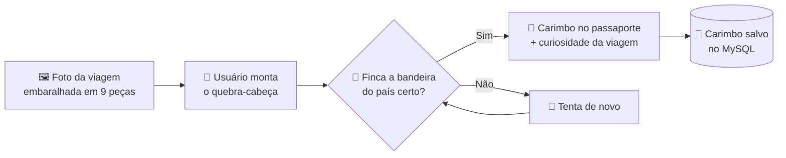
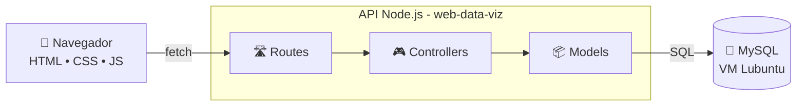
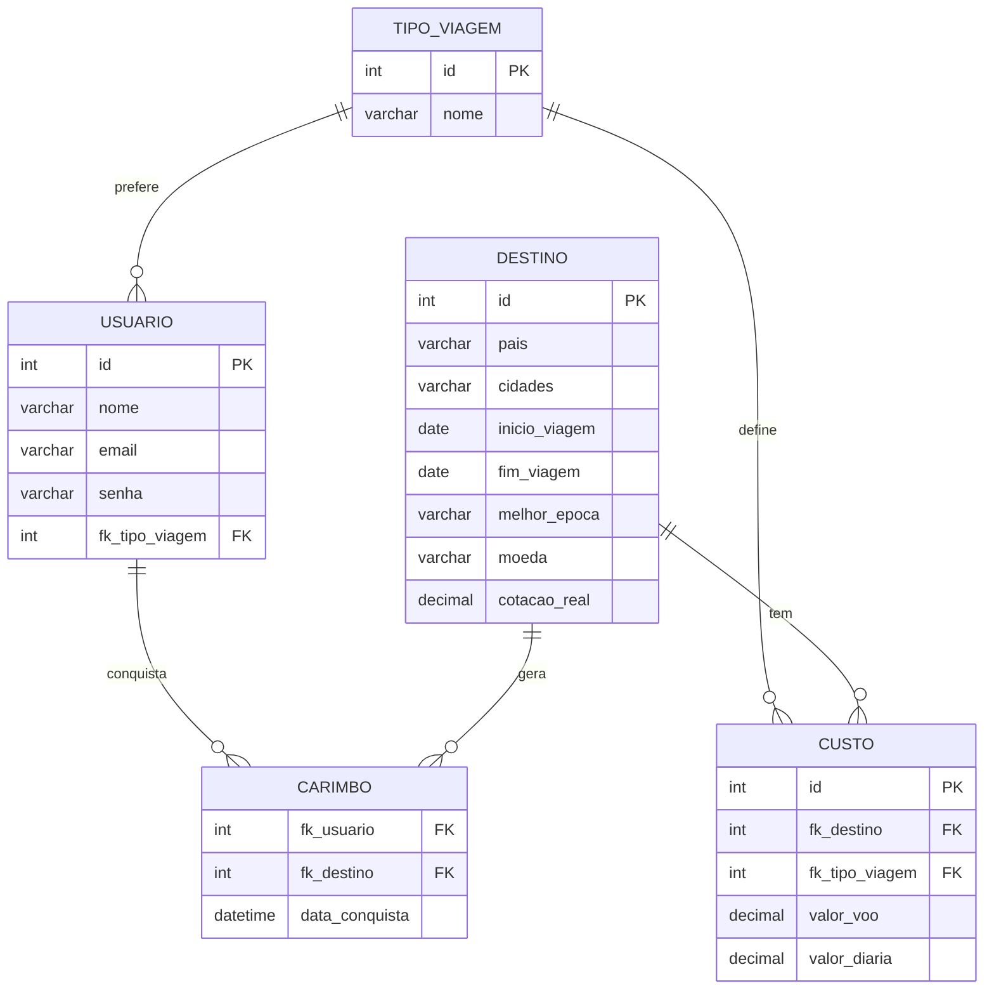

<!-- Cabeçalho animado -->
<p align="center">
  
</p>

<p align="center">
  <a href="#">
    
  </a>
</p>

<p align="center">
  
  
  
</p>

<p align="center">
  <a href="#-sobre">Sobre</a> •
  <a href="#-destinos">Destinos</a> •
  <a href="#-funcionalidades">Funcionalidades</a> •
  <a href="#-o-jogo-do-passaporte">Jogo</a> •
  <a href="#-tecnologias">Tecnologias</a> •
  <a href="#-arquitetura">Arquitetura</a> •
  <a href="#-como-executar">Como executar</a> •
  <a href="#-cronograma">Cronograma</a>
</p>

---

## 📖 Sobre

**Meu Passaporte** é um site pessoal onde compartilho os países que já conheci. Além de contar cada viagem, o site ajuda quem visita a descobrir **quanto custaria fazer a mesma viagem saindo de São Paulo**, de acordo com o seu estilo: **aventura**, **low cost** ou **exclusiva**.

Para deixar tudo mais divertido, cada país vira uma fase de um jogo: monte o quebra-cabeça de uma foto da viagem, finque a bandeira certa e ganhe um carimbo no seu passaporte! 🛂

> Projeto Individual do 1º semestre (2026.2) da SPTech, integrando as disciplinas de Pesquisa e Inovação, Banco de Dados, Algoritmos, Arquitetura de Computadores, Sistemas Operacionais, TI e Socioemocional.

---

## 🌍 Destinos

| | País | Cidades | Quando |
|:-:|---|---|---|
| 🇨🇱 | **Chile** | Deserto do Atacama | 11/2016 a 02/2017 |
| 🇦🇷 | **Argentina** | Mendoza | 12/2023 a 01/2024 |
| 🇪🇸 | **Espanha** | Madrid, Sevilha, Utrera, Cádiz, Ronda | 06/2024 a 07/2024 |
| 🇵🇹 | **Portugal** | Lisboa, Algarve, Portimão | 07/2024 |
| 🇬🇮 | **Gibraltar** | Gibraltar (território britânico) | 07/2024 a 08/2024 |
| 🇲🇿 | **Moçambique** | Maputo, Ponta do Ouro | 08/2024 a 10/2024 |
| 🇺🇸 | **Estados Unidos** | Orlando | 09/2026 |

---

## ✨ Funcionalidades

- [ ] 🏠 **Home pública** com a linha do tempo das viagens
- [ ] 📝 **Cadastro e login** com validações em JavaScript
- [ ] 🙋 **Sobre mim**, contando como a paixão por viajar começou
- [ ] 🎒 **Escolha do tipo de viagem**: aventura, low cost ou exclusiva
- [ ] 📊 **Dashboard** com o custo total da viagem para cada destino (7, 15 ou 30 dias)
- [ ] ✈️ **Indicadores**: estimativa de voo, melhor época do ano e destino mais barato
- [ ] 💱 **Conversão de moeda** local para real
- [ ] 🧩 **Jogo do Passaporte** com carimbos salvos no banco

> Dashboard, Sobre mim e Jogo só aparecem para quem está logado.

### 🧮 Como o custo é calculado

```
custo total = valor do voo (SP → destino) + valor da diária × número de dias
```

---

## 🧩 O jogo do Passaporte



Cada um dos 7 países é uma fase. Ao completar todas, o passaporte fica cheio! 🏆

---

## 🛠️ Tecnologias

<p align="center">
  
</p>

| Camada | Tecnologia |
|---|---|
| Front-end | HTML, CSS, JavaScript, Chart.js |
| Back-end | Node.js + Express (API [web-data-viz](https://github.com/BandTec/web-data-viz)) |
| Banco de dados | MySQL em uma VM Lubuntu (VirtualBox) |
| Organização | Git, GitHub e Trello |

---

## 🏗️ Arquitetura



### 🗄️ Modelo de dados



---

## 🚀 Como executar

```bash
# 1. Clone o repositório
git clone https://github.com/FerKaGe/Passport.git
cd Passport

# 2. Instale as dependências
npm install

# 3. Crie o banco na VM executando o script SQL
#    src/database/script-tabelas.sql

# 4. Configure o acesso ao banco no arquivo .env.dev
#    (host da VM, usuário, senha e nome do banco)

# 5. Inicie a aplicação
npm start
```

Depois é só acessar `http://localhost:3333` no navegador. 🌐

---

## 📅 Cronograma

| Semana | Período | Entrega | Status |
|:-:|---|---|:-:|
| 2 | 25/10 a 31/10 | Documentação, Git, Trello e banco de dados | ⏳ |
| 3 | 01/11 a 07/11 | Home e Sobre mim | ⏳ |
| 4 | 08/11 a 14/11 | Cadastro, login e quebra-cabeça | ⏳ |
| 5 | 15/11 a 21/11 | Dashboard e carimbos do passaporte | ⏳ |
| 6 | 22/11 a 28/11 | Testes, apresentação e ensaio | ⏳ |
| 🎤 | 30/11 a 04/12 | Apresentação para a banca | ⏳ |

---

## 🤖 Uso de IA

Este projeto usa IA como apoio para tirar dúvidas, revisar código e planejar. Tudo o que foi pedido, usado e alterado está registrado no [**Diário de Prompts**](./diario-de-prompts.md).

---

## 👤 Autor

<p align="center">
  Feito com ❤️ e muitas milhas por <a href="https://github.com/FerKaGe"><b>FerKaGe</b></a>
</p>

<p align="center">
  
</p>
